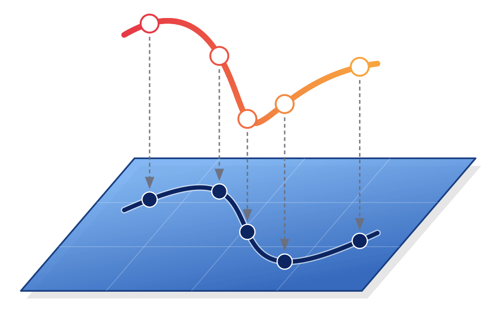
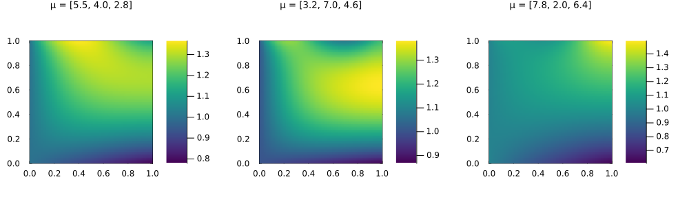
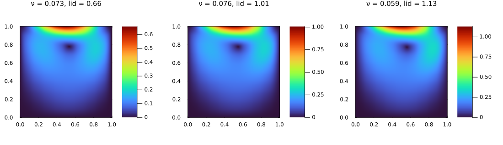
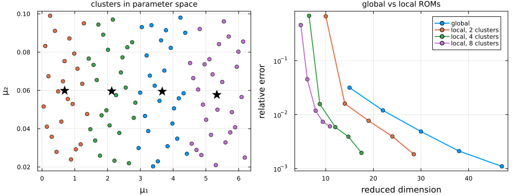
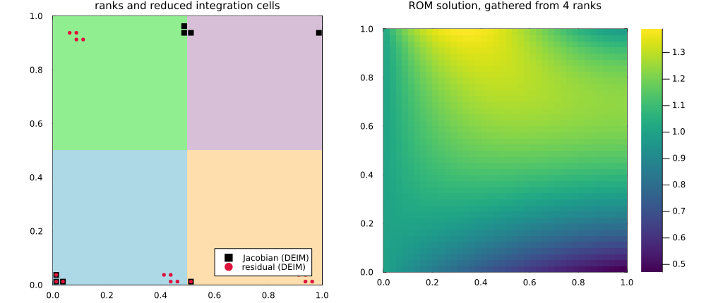
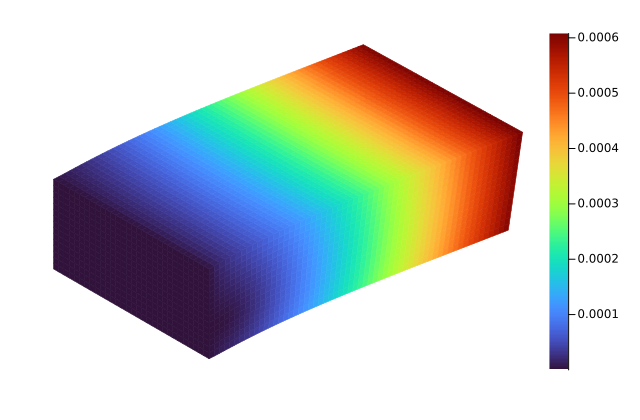
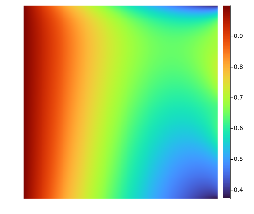
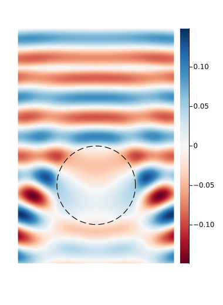
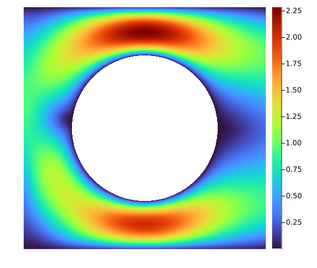
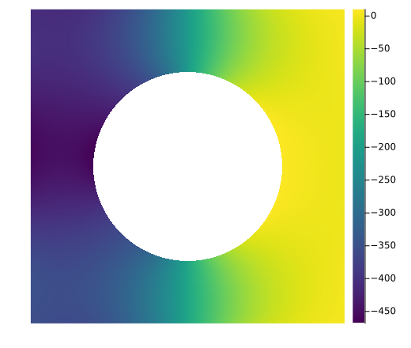

<p align="center">
  
</p>

# GridapROMs

| **Documentation** |
|:------------ |
| [](https://gridap.github.io/GridapROMs.jl/dev/) |
| **Build Status** |
| [](https://github.com/gridap/GridapROMs.jl/actions/workflows/ci.yml) [](https://codecov.io/gh/gridap/GridapROMs.jl) |
| **Citation** |
| [](https://doi.org/10.1016/j.cpc.2025.109985) |

## What

GridapROMs provides a set of tools for the reduced order modelling (ROM) of parameterised partial differential equations (PDEs), written in the Julia programming language. When a PDE must be solved for many values of its parameters (design, optimisation, uncertainty quantification, control), high-fidelity solvers quickly become unaffordable. ROMs replace them with surrogates that are orders of magnitude cheaper, at a controlled loss of accuracy.

GridapROMs is built on top of [Gridap](https://github.com/gridap/Gridap.jl), and inherits its expressive API: parameterised problems are written exactly as in Gridap, with the parameter `μ` as an extra argument. The library currently supports

- steady and transient, linear and nonlinear, single- and multi-field problems
- reduced bases built with POD or tensor-train (TT-SVD) decompositions, in any norm, with supremizer enrichment for saddle-point problems
- hyper-reduction with DEIM, S-OPT and radial basis function interpolation, per integration domain
- global and local (clustered) reduced operators
- distributed-memory parallelism of the whole offline and online phases, via [GridapDistributed](https://github.com/gridap/GridapDistributed.jl)

A reduced order model of a parameterised Poisson problem takes a few lines of code:

```julia
using Gridap, GridapROMs

D = ParamSpace((1,10,1,10))
model = CartesianDiscreteModel((0,1,0,1),(40,40))
Ω = Triangulation(model)
dΩ = Measure(Ω,2)
V = TestFESpace(Ω,ReferenceFE(lagrangian,Float64,1);dirichlet_tags="boundary")
U = ParamTrialFESpace(V)

κ(μ) = x -> 1 + μ[1]*exp(-μ[2]*x[1]*x[2])
a(μ,u,v) = ∫(parameterise(κ,μ)*∇(v)⋅∇(u))dΩ
l(μ,v) = ∫(v)dΩ
feop = LinearParamOperator(l,a,D,U,V,FEDomains((Ω,),(Ω,)))

rbsolver = RBSolver(LUSolver(),Reduction(1e-4,H1();nparams=50))
rbop = reduced_operator(rbsolver,feop)         # offline phase
μ = realisation(feop;nparams=10)
û = solution_snapshots(rbsolver,rbop,μ)        # online phase
```

## Documentation

- [**DEVEL**](https://gridap.github.io/GridapROMs.jl/dev/) — *Documentation for the most recent in-development version of GridapROMs.*

## Tutorials

A hands-on introduction to the library is available as a set of tutorials in the documentation:

1. [Parameterised PDEs](https://gridap.github.io/GridapROMs.jl/dev/tutorials/t001_parameterised_pdes/)
2. [Reduced order models](https://gridap.github.io/GridapROMs.jl/dev/tutorials/t002_reduced_order_models/)
3. [Local reduced operators](https://gridap.github.io/GridapROMs.jl/dev/tutorials/t003_local_roms/)
4. [Distributed-memory ROMs](https://gridap.github.io/GridapROMs.jl/dev/tutorials/t004_distributed/)

## Installation

GridapROMs is a registered package in the official [Julia package registry](https://github.com/JuliaRegistries/General). Open the Julia REPL, type `]` to enter package mode, and install as follows

```julia
pkg> add GridapROMs
```

## Examples

These are some problems solved with GridapROMs, taken from the [tutorials](https://gridap.github.io/GridapROMs.jl/dev/) and from the [examples](examples) folder.

<table>
  <tr>
    <td align="center" width="25%"><a href="https://gridap.github.io/GridapROMs.jl/dev/tutorials/t001_parameterised_pdes/"></a><br><a href="https://gridap.github.io/GridapROMs.jl/dev/tutorials/t001_parameterised_pdes/">Parameterised Poisson equation</a></td>
    <td align="center" width="25%"><a href="https://gridap.github.io/GridapROMs.jl/dev/tutorials/t002_reduced_order_models/"></a><br><a href="https://gridap.github.io/GridapROMs.jl/dev/tutorials/t002_reduced_order_models/">Navier-Stokes, lid-driven cavity</a></td>
    <td align="center" width="25%"><a href="https://gridap.github.io/GridapROMs.jl/dev/tutorials/t003_local_roms/"></a><br><a href="https://gridap.github.io/GridapROMs.jl/dev/tutorials/t003_local_roms/">Local ROMs, advection-diffusion</a></td>
    <td align="center" width="25%"><a href="https://gridap.github.io/GridapROMs.jl/dev/tutorials/t004_distributed/"></a><br><a href="https://gridap.github.io/GridapROMs.jl/dev/tutorials/t004_distributed/">Distributed ROMs</a></td>
  </tr>
  <tr>
    <td align="center" width="25%"><a href="examples/SteadyElasticityPOD.jl"></a><br><a href="examples/SteadyElasticityPOD.jl">Linear elasticity, POD</a></td>
    <td align="center" width="25%"><a href="examples/AdvectionDiffusionTTSVD.jl"></a><br><a href="examples/AdvectionDiffusionTTSVD.jl">Advection-diffusion, TT-SVD</a></td>
    <td align="center" width="25%"><a href="examples/HelmholtzPOD.jl"></a><br><a href="examples/HelmholtzPOD.jl">Electromagnetic scattering, POD</a></td>
    <td align="center" width="25%"><a href="examples/SteadyStokesPOD.jl"></a><br><a href="examples/SteadyStokesPOD.jl">Stokes flow, POD</a></td>
  </tr>
  <tr>
    <td align="center" width="25%"><a href="examples/HeatEquationSTRB.jl"></a><br><a href="examples/HeatEquationSTRB.jl">Heat equation, space-time RB</a></td>
    <td align="center" width="25%"><a href="examples/NStokesTransientSTRB.jl"></a><br><a href="examples/NStokesTransientSTRB.jl">Navier-Stokes velocity, space-time RB</a></td>
    <td align="center" width="25%"><a href="examples/NStokesTransientSTRB.jl"></a><br><a href="examples/NStokesTransientSTRB.jl">Navier-Stokes pressure, space-time RB</a></td>
    <td align="center" width="25%"><a href="examples/SteadyStokesPOD.jl"></a><br><a href="examples/SteadyStokesPOD.jl">Stokes pressure, POD</a></td>
  </tr>
</table>

Some of the examples load geometries stored in [`docs/src/assets/models.zip`](docs/src/assets/models.zip): unzip it into the `data` folder of the active project, given by `DrWatson.datadir()`.

## How to cite GridapROMs

In order to give credit to the GridapROMs contributors, we simply ask you to cite the reference below in any publication in which you have made use of GridapROMs:

```
@article{MUELLER2026109985,
  title = {GridapROMs.jl: Efficient reduced order modelling in the Julia programming language},
  journal = {Computer Physics Communications},
  volume = {320},
  pages = {109985},
  year = {2026},
  issn = {0010-4655},
  doi = {https://doi.org/10.1016/j.cpc.2025.109985},
  url = {https://www.sciencedirect.com/science/article/pii/S0010465525004862},
  author = {Nicholas Mueller and Santiago Badia},
  keywords = {PDE, Reduced order model, Julia}
}
```

## Contact

Please open an [issue](https://github.com/gridap/GridapROMs.jl/issues) for questions, bug reports and feature requests.
